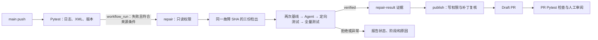

# CI 故障自动修复架构

本页描述受控示例仓库的 pytest 修复链路。示例仓库的 `main` 出现测试失败后，系统尝试生成补丁，独立验证，再创建供人审阅的 Draft PR。下文的实现链接固定在已用于[线上案例](https://github.com/fuziran/ci-repair-demo/pull/6)的 Agent 提交 `1fde1e64732783ed8f01c31273c5dd179e56f9ae`；示例仓库为私有仓库，查看运行和 PR 需要访问权限。

## 事件入口与版本固定

[示例 Pytest 工作流](https://github.com/fuziran/mini-swe-agent/blob/1fde1e64732783ed8f01c31273c5dd179e56f9ae/examples/ci_repair_demo/.github/workflows/pytest.yml)在 `main` 推送和面向 `main` 的 PR 上运行，保存原始 `pytest.log`、`pytest.xml` 和 Python/pytest 版本。其权限为 `contents: read`。[修复工作流](https://github.com/fuziran/mini-swe-agent/blob/1fde1e64732783ed8f01c31273c5dd179e56f9ae/examples/ci_repair_demo/.github/workflows/repair.yml)监听 `Pytest` 的 `workflow_run: completed`，只接受同仓库 `main` 推送导致的失败；检出失败运行的完整 SHA，并下载**该运行**的 `pytest-log`。Agent 仓库由 `AGENT_REF` 完整 SHA 固定，运行时将 Agent SHA、故障 SHA、运行 ID、镜像及配置写入 `runtime.json`。修复入口还核对工作流名称及检出的 HEAD 与故障 SHA 一致。

修复工作流按故障 SHA 设置并发组，`cancel-in-progress: false`、`queue: max`。同一 SHA 的两次新修复运行曾分别处于执行中和等待中，随后串行完成；发布阶段没有观察到重叠或第二个 PR，详见[运行 38863447981](https://github.com/fuziran/ci-repair-demo/actions/runs/38863447981)、[运行 38863664834](https://github.com/fuziran/ci-repair-demo/actions/runs/38863664834)及本地留存的 `eval/evidence/online-14-4/summary.md`。这只证明该次同 SHA 竞争实测。

## 三份检出与执行边界

[修复入口](https://github.com/fuziran/mini-swe-agent/blob/1fde1e64732783ed8f01c31273c5dd179e56f9ae/src/minisweagent/run/ci_repair.py)从失败提交建立三个独立的临时 Git 检出，全部处于该 SHA：

| 检出 | 用途 | 写入边界 |
| --- | --- | --- |
| `baseline` | 原样运行全量 pytest 两次，确认故障可复现且节点结果稳定 | Agent 不接触；测试容器只读挂载 |
| `agent` | Agent 搜索、读取、运行测试并提出源码补丁 | 容器只读挂载；`apply_patch` 由宿主进程写入这份检出 |
| `candidate` | 应用导出的补丁，运行原失败节点及全量测试 | Agent 不接触；仅宿主应用补丁，测试容器只读挂载 |

[RepositoryEnvironment](https://github.com/fuziran/mini-swe-agent/blob/1fde1e64732783ed8f01c31273c5dd179e56f9ae/src/minisweagent/environments/repository.py)为 Agent 的 Bash 与测试命令使用禁网、只读源码挂载的 Docker 容器，并限制 CPU、内存、进程和能力；文件搜索与补丁应用由宿主环境工具处理。[验证器的 pytest 容器](https://github.com/fuziran/mini-swe-agent/blob/1fde1e64732783ed8f01c31273c5dd179e56f9ae/src/minisweagent/run/ci_repair.py)同样禁网、只读挂载源码，用独立的可写结果目录保存每次 XML，并在运行前删除该次旧 XML。模型调用由修复作业中的宿主进程完成，容器禁网不表示整个修复作业离线。

## 验证器与拒绝状态

原 CI 的 XML 优先提供失败节点；XML 不存在时才从文本日志提取。首次基线必须重现完全相同的失败节点，第二次基线的每个节点结果必须一致。Agent 完成后，仅允许修改已有的 `src/*.py`，不接受未跟踪文件、重命名或文件类型变化；补丁先在独立 `candidate` 检出中检查并应用。随后，原失败节点的定向测试必须全部实际通过；候选全量测试必须通过、保留基线节点集合、使原失败节点通过且不新增跳过。四次测试各有独立日志和 XML。详细判定及 XML 无效时的处理见[候选验证规则](ci-repair-validation.md)，实现见[ci_repair.py](https://github.com/fuziran/mini-swe-agent/blob/1fde1e64732783ed8f01c31273c5dd179e56f9ae/src/minisweagent/run/ci_repair.py)。

输出目录创建成功后，入口在退出前写 `report.json`：状态、失败阶段、安全原因、耗时，以及能取得的模型调用数和费用。主要拒绝状态如下；非超时执行异常还记录异常类型，已产生的原始日志与轨迹留在证据中供受控审阅。

| 阶段 | 状态 | 含义 |
| --- | --- | --- |
| 输入 | `invalid_input`、`pytest_error`、`not_pytest_failure` | 输入不符、原 CI 收集/设置错误或没有失败节点 |
| 两次基线 | `not_reproduced`、`unstable` | 故障不一致或节点结果不稳定 |
| Agent 与补丁 | `agent_incomplete`、`invalid_changes`、`patch_error` | 未提交有效结果、改动越界或补丁无法应用 |
| 候选测试 | `target_failed`、`candidate_failed` | 定向测试或全量节点级验证未通过 |
| 执行异常 | `timeout`、`checkout_error`、`agent_error`、`execution_error` | 超时或相应阶段运行失败，包括 XML 缺失、损坏或与退出码矛盾 |
| 全部通过 | `verified` | 才允许进入发布作业；仍需 PR 检查和人工审阅 |

## 发布权限与人工关口

[修复作业](https://github.com/fuziran/mini-swe-agent/blob/1fde1e64732783ed8f01c31273c5dd179e56f9ae/examples/ci_repair_demo/.github/workflows/repair.yml)仅有 `contents: read`、`actions: read`，模型密钥只传给调用修复入口的步骤；无论结果如何，上传 `repair-result` 证据。独立的 `publish` 作业只在修复作业成功时启动，才获得 `contents: write` 与 `pull-requests: write`。它重新检查 `verified` 报告、原运行 ID 和故障 SHA，要求远端 `main` 尚未前进，复核补丁只能修改已有 `src/*.py` 且与报告一致，然后使用由故障 SHA 派生的分支；已有同分支 PR 时不再创建，已有分支的树也须与候选一致。最终创建的是 **Draft PR**，不会自动合并。

[本次线上 Draft PR #6](https://github.com/fuziran/ci-repair-demo/pull/6)来自[原失败 Pytest 运行](https://github.com/fuziran/ci-repair-demo/actions/runs/38862204427)和[修复运行](https://github.com/fuziran/ci-repair-demo/actions/runs/38862229869)。维护者曾人工批准该 PR 的工作流，[PR Pytest 检查](https://github.com/fuziran/ci-repair-demo/actions/runs/38862433446)随后通过；PR 仍为 Draft，未提交正式 PR review，也未合并。本地审计记录在 `eval/evidence/online-14-5/summary.md` 和 `eval/evidence/online-14-6/summary.md`，这些原始证据目录受 Git 忽略。此次故障是冻结评估案例 E01 的衍生线上演示，**不计入冻结的 20 例**。
